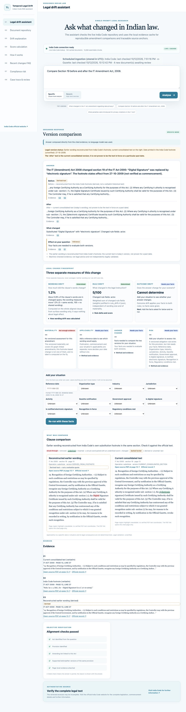
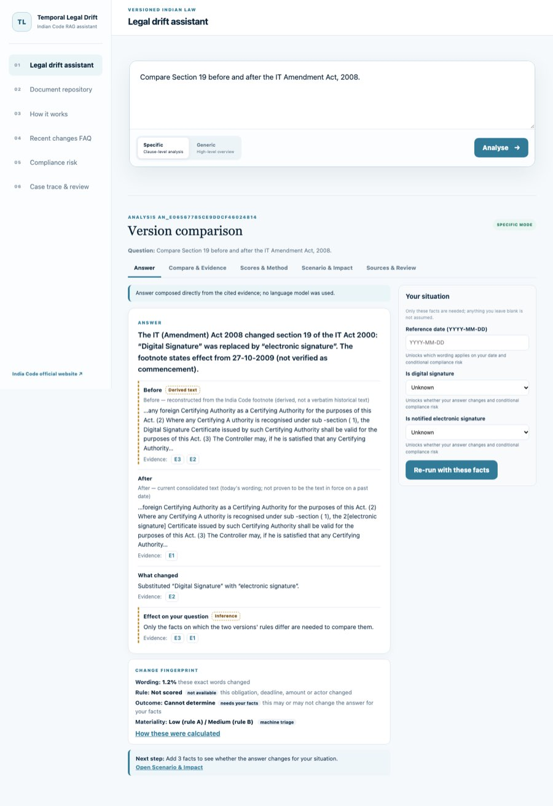
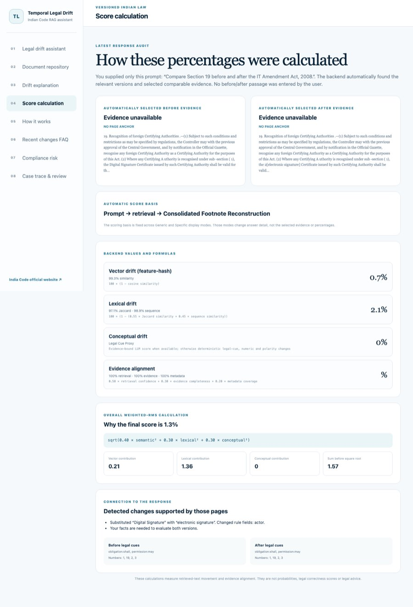
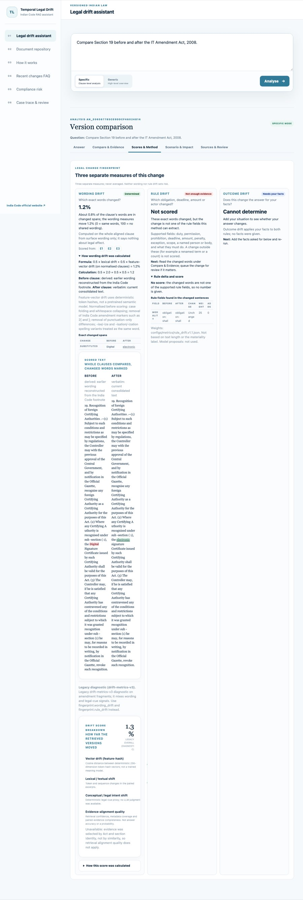
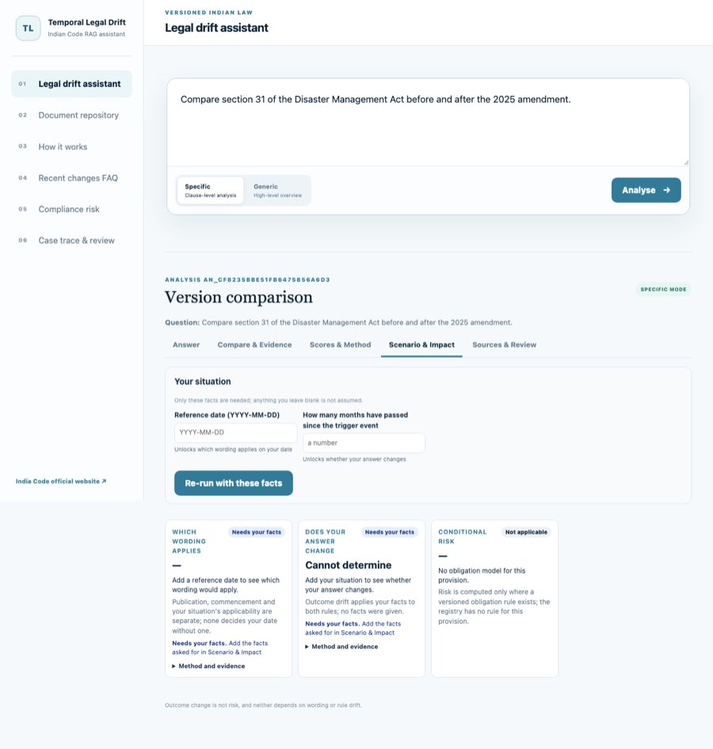
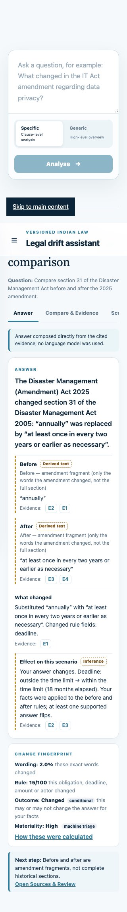

# Analysis workspace: audit and redesign (rag-answer-v4, 2026-10-13)

This is an engineering report. No result here is legal advice, gold labelling or expert-validated. **Legal validation: UNVERIFIED.** Decision record: ADR 0016. Method changes: `docs/methodology/legal_change_fingerprint.v1.1.md`.

## What the v0.13.0 audit found

The query was "Compare Section 19 before and after the IT Amendment Act, 2008." in Specific mode, run at `127.0.0.1:8765` (read-only) and on a local replica.

| Problem | Cause in code | Fix |
| --- | --- | --- |
| "Drift explanation" and "Score calculation" pages showed "Evidence unavailable / NO PAGE ANCHOR" and the legacy 1.3% instead of the answer's clauses | Separate navigation pages rebuilt their view from browser state and the legacy metrics | One stored analysis (`analysis_id`), fetched by ID. Scores & Method shows the fingerprint with the exact scored clauses and "Scored from: E…" links |
| Results lost after a refresh or a pasted link | The result lived only in React state | `#analysis/<id>/<view>` and `GET /api/analyses/<id>`; a hash change in an open tab re-opens the stored record |
| One 4,869px page with 7 cards, 6 saying "needs facts" or "not enough evidence" | Every determination rendered as a card on one page | Five views. The Answer view (1,865px) shows the answer, a 3-line fingerprint strip and **one** next step |
| No way to supply the facts that were asked for | The only form listed all registry facts (11 for IT s.19), away from the answer | `scenario_request` lists only the decisive facts (IT s.19: date plus 2; DM s.31: date plus months; MV s.173: date plus amount). The form sits beside the answer and re-runs the same question |
| Missing evidence looked like missing facts | Untyped NEEDS/INSUFFICIENT states | `limit.kind` is evidence, facts, method or not_applicable. Facts are never requested for an evidence gap; the UI says "Facts cannot fill missing legal evidence" |
| IT s.19 rule drift "5/100 (actor changed)" | The heuristic read "Certifying Authority" from the qualifier "Certificate issued by such Certifying Authority" as the provision's actor | rule-drift-v1.1: the actor must be a legal-actor head noun before any qualifier. An unsupported change is **Not scored** (method limit), never a number |
| Materiality "not assessed" without a silver row | Only frozen silver rows were looked up | On-the-fly machine triage (rules A and B) from aligned evidence, labelled PROVISIONAL and `ON_THE_FLY_MACHINE_TRIAGE`. Silver matches are labelled `FROZEN_SILVER_SET`. Neither is gold |
| (found during verification) A stored record from older code was served under the same ID | The ID did not include the method versions | The identity now includes the determinations, fingerprint, composition and metrics versions and the generation method. A regression test covers it |
| (found during verification) A unit test wrote runtime records into the repository | `test_webapp` called `query_rag` against the repository root | Storage is stubbed in that test |

## Screenshots

| Before (v0.13.0) | After (v4) |
| --- | --- |
|  |  |
|  |  |
| |   |

## Example queries across the corpus (audit cases v3: 27 cases, 12 Acts)

Offline, deterministic composition. Audit summary: 27/27 expected states, with 0 support, pairing or citation errors. "Facts still asked" is the core group of `scenario_request`. Risk-only facts are optional and not listed.

| Case (stratum) | Question | Support | Wording | Rule | Outcome | Materiality (triage) | Facts still asked | Result |
|---|---|---|---|---|---|---|---|---|
| it-s19-risk-match (scenario_risk_rule_match) | Compare Section 19 before and after the IT Amendment Act, 2008. | CONSOLIDATED_FOOTNOTE_RECONSTRUCTION | 1.2% | Not scored | Changed | Low (rule A) / Medium (rule B) | — | supported for the stated facts |
| dm-s31-month6-unchanged (numeric_period_scenario_no_flip) | How often must the district disaster management plan be reviewed under… | GRAPH_TRANSITION_FRAGMENTS | 2.0% | 15/100 | Unchanged | High | reference_date | supported for the stated facts |
| dm-s31-month18-changed (numeric_period_scenario_flip) | How often must the district disaster management plan be reviewed under… | GRAPH_TRANSITION_FRAGMENTS | 2.0% | 15/100 | Changed | High | reference_date | supported for the stated facts |
| dm-s31-fact-in-question (fact_stated_in_question) | After 18 months without a review, is the district disaster management … | GRAPH_TRANSITION_FRAGMENTS | 2.0% | 15/100 | Changed | High | reference_date | supported for the stated facts |
| arb-s7-specific (supported_transition_insert_dated_silver) | How did section 7 of the Arbitration and Conciliation Act change after… | GRAPH_TRANSITION_FRAGMENTS | 1.9% | 10/100 | Cannot determine | High | reference_date | conditional on facts |
| arb-s7-generic (mode_invariance) | How did section 7 of the Arbitration and Conciliation Act change after… | GRAPH_TRANSITION_FRAGMENTS | 1.9% | 10/100 | Cannot determine | High | reference_date | conditional on facts |
| arb-s23-counterclaim (insert_answer_change_conditional) | Can a respondent submit a counterclaim in the statement of defence und… | GRAPH_TRANSITION_FRAGMENTS | 8.4% | 25/100 | Cannot determine | High | reference_date, within_scope | conditional on facts |
| mv-s173-deposit (numeric_substitution_silver_undated) | What amount must be deposited under section 173 of the Motor Vehicles … | GRAPH_TRANSITION_FRAGMENTS | 1.8% | 15/100 | Cannot determine | Low | reference_date, amount | conditional on facts |
| cpc-s32-fine (numeric_substitution_no_silver) | What is the maximum fine a court can impose under section 32 of the Co… | GRAPH_TRANSITION_FRAGMENTS | 1.6% | 15/100 | Cannot determine | Low | reference_date, amount | conditional on facts |
| mv-s181-penalty (numeric_substitution_no_silver) | What was the penalty under section 181 of the Motor Vehicles Act befor… | GRAPH_TRANSITION_FRAGMENTS | 5.2% | 30/100 | Cannot determine | Low (rule A) / Medium (rule B) | reference_date, amount, contravention | conditional on facts |
| sra-s11-discretion (modal_substitution_no_silver) | Is specific performance of a contract still discretionary under sectio… | GRAPH_TRANSITION_FRAGMENTS | 5.4% | 25/100 | Cannot determine | High | reference_date, within_scope | conditional on facts |
| patents-s60-period (period_substitution_no_silver) | What time period applies under section 60 of the Patents Act after the… | GRAPH_TRANSITION_FRAGMENTS | 1.9% | 15/100 | Cannot determine | Low (rule A) / Medium (rule B) | reference_date, elapsed_months | conditional on facts |
| brega-s45zc-nominees (numeric_substitution_silver) | How many nominees can a depositor make under section 45ZC of the Banki… | GRAPH_TRANSITION_FRAGMENTS | 1.8% | Not scored | Cannot determine | Low | reference_date | conditional on facts |
| companies-s46-compare (comparison_silver) | Compare section 46 of the Companies Act before and after the Companies… | GRAPH_TRANSITION_FRAGMENTS | 4.2% | Not scored | Cannot determine | Low | reference_date | conditional on facts |
| rti-s13-term (substitution_no_silver) | What is the term of office of the Chief Information Commissioner under… | GRAPH_TRANSITION_FRAGMENTS | 0.7% | 15/100 | Cannot determine | Medium | reference_date | conditional on facts |
| it-s19-specific (footnote_reconstruction) | Compare Section 19 before and after the IT Amendment Act, 2008. | CONSOLIDATED_FOOTNOTE_RECONSTRUCTION | 1.2% | Not scored | Cannot determine | Low (rule A) / Medium (rule B) | reference_date, is_digital_signature, is_notified_electronic_signature | conditional on facts |
| it-s19-generic (footnote_reconstruction_generic) | Compare Section 19 before and after the IT Amendment Act, 2008. | CONSOLIDATED_FOOTNOTE_RECONSTRUCTION | 1.2% | Not scored | Cannot determine | Low (rule A) / Medium (rule B) | reference_date, is_digital_signature, is_notified_electronic_signature | conditional on facts |
| it-s19-risk-mismatch (scenario_risk_rule_mismatch) | Compare Section 19 before and after the IT Amendment Act, 2008. | CONSOLIDATED_FOOTNOTE_RECONSTRUCTION | 1.2% | Not scored | Cannot determine | Low (rule A) / Medium (rule B) | is_digital_signature | conditional on facts |
| companies-s105-footnote (footnote_reconstruction_partial_answer_change_vs_text) | What penalty applies under section 105 of the Companies Act after the … | CONSOLIDATED_FOOTNOTE_RECONSTRUCTION | 0.8% | 35/100 | Cannot determine | High | reference_date, amount, contravention | conditional on facts |
| dm-s31-frequency (frequency_substitution_no_silver) | How often must the district disaster management plan be reviewed under… | GRAPH_TRANSITION_FRAGMENTS | 2.0% | 15/100 | Cannot determine | High | reference_date, elapsed_months | conditional on facts |
| it-2008-privacy-ocr (poor_ocr_unaligned) | What changed in the IT Act amendment regarding data privacy? | NO_SUPPORTED_VERSION | INSUFFICIENT_EVIDENCE | INSUFFICIENT_EVIDENCE | Cannot determine | INSUFFICIENT_EVIDENCE | — | justified abstention |
| wrong-act-companies-competition (wrong_act_rejection) | Compare section 46 of the Companies Act before and after the Competiti… | RELATION_MISMATCH | INSUFFICIENT_EVIDENCE | INSUFFICIENT_EVIDENCE | Cannot determine | INSUFFICIENT_EVIDENCE | — | justified abstention |
| wildlife-s11-omission (omission_unsupported) | What was omitted from section 11 of the Wild Life (Protection) Act by … | WEAK_TRANSITION_ONLY | INSUFFICIENT_EVIDENCE | INSUFFICIENT_EVIDENCE | Cannot determine | INSUFFICIENT_EVIDENCE | — | justified abstention |
| factories-not-in-graph (act_without_amendment_source) | Compare section 2 of the Factories Act before and after the 2016 amend… | NO_SUPPORTED_VERSION | INSUFFICIENT_EVIDENCE | INSUFFICIENT_EVIDENCE | Cannot determine | INSUFFICIENT_EVIDENCE | — | justified abstention |
| cpa-mediation-general (general_qa) | What does the Consumer Protection Act say about mediation? | NOT_A_COMPARISON | OUT_OF_SCOPE | OUT_OF_SCOPE | OUT_OF_SCOPE | OUT_OF_SCOPE | — | general QA (no comparison) |
| thoa-punishment-general (general_qa) | What is the punishment for removal of human organs without authority u… | NOT_A_COMPARISON | OUT_OF_SCOPE | OUT_OF_SCOPE | OUT_OF_SCOPE | OUT_OF_SCOPE | — | general QA (no comparison) |
| jan-vishwas-general (general_qa_amending_act) | What happened in the Jan Vishwas Act? | NOT_A_COMPARISON | OUT_OF_SCOPE | OUT_OF_SCOPE | OUT_OF_SCOPE | OUT_OF_SCOPE | — | general QA (no comparison) |

How to read the table:
- **Supported for the stated facts:** the change is evidenced and the user's facts decide the outcome. The DM s.31 deadline flips at 18 months but not at 6. A date is still requested because applicability on a date is separate from the outcome.
- **IT s.19 risk-match:** rule drift is *Not scored* (a definitional substitution is not a supported rule field), yet the outcome is *Changed*. The obligation registry evaluates the two versions directly on the decisive fact (`is_digital_signature`), with the shared conditions stated as assumed.
- **Conditional on facts:** the change itself is evidenced, but whether it changes *your* answer needs the listed facts.
- **Justified abstention:** the evidence cannot support a comparison. Causes: unreliable OCR, the wrong amending Act, weak omission support, or no amendment source. No facts are requested, and the reason is shown as an evidence limit.

## Verification executed

- Python: 277 tests under 3.14 and 3.11. Before the release only the Phase 11 checksum gate fails, as expected. `validate-contract` passes.
- Frontend: 24 vitest tests against real v4 backend responses (`fixtures/rag_answer_v4.json`), covering:
  - one analysis across five views;
  - citation-to-score linkage;
  - no rule score for an unsupported field;
  - the minimum-facts form and its re-run payload;
  - facts read from the question;
  - the deadline flip for one scenario and not another;
  - evidence versus facts;
  - OCR and out-of-scope abstention;
  - machine-triage labelling;
  - deep links and refresh through `App`;
  - arrow keys and labels;
  - narrow-screen CSS.
- Real Chrome (my own server on 8799):
  - every view rendered for IT s.19 and DM s.31;
  - refresh keeps the view;
  - a pasted `#analysis/<id>/scores` link opens Scores;
  - a facts re-run, typing 18 months and a date, changes DM s.31 outcome to "Changed (conditional)";
  - ArrowRight and End move between views;
  - no unlabelled controls;
  - no horizontal page scroll at 320, 360, 400, 414 and 480px.
- `frontend/scripts/browser-a11y-check.mjs`, updated for the views: arrows reach Scores, Enter and Space toggle the explanation, every control is named, and focus is always visible.
  - Text under 10px dropped from 18 elements to 3 (Answer view).
  - Targets under 24px dropped from 23–26 to 5–9.

## Not verified

- Legal correctness of any determination, triage label, decisive fact or assumption.
- A listening pass with a screen reader (VoiceOver or NVDA). Only the accessibility tree was checked.
- An LLM-generated general answer against a live model. Only the deterministic and extractive paths ran.
- **Known method limitation:** materiality rule A ignores number words (CPC s.32 triages Low).
