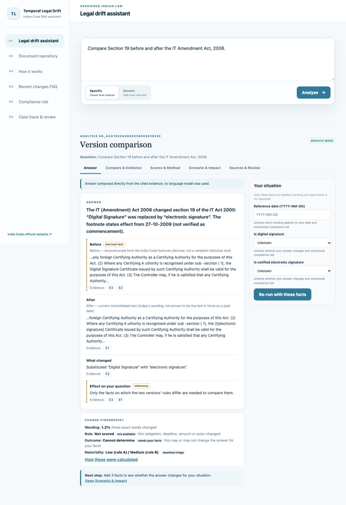
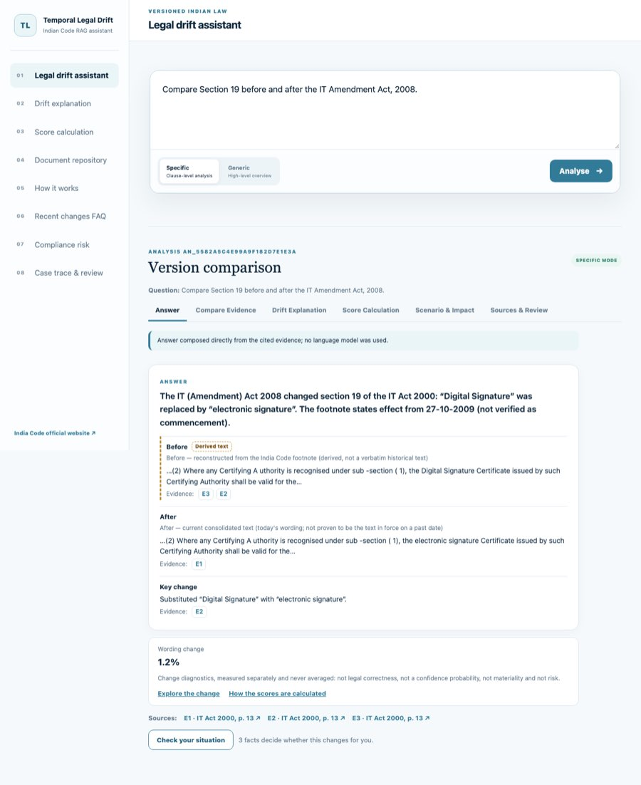
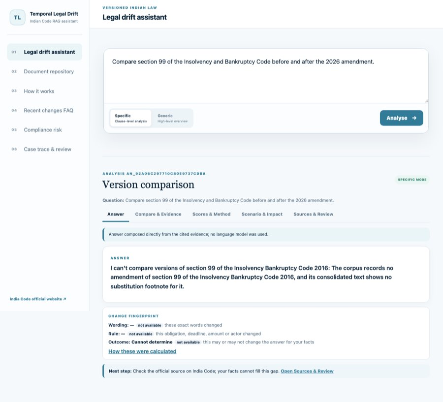
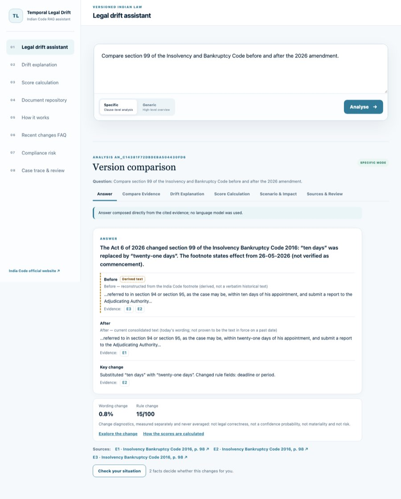
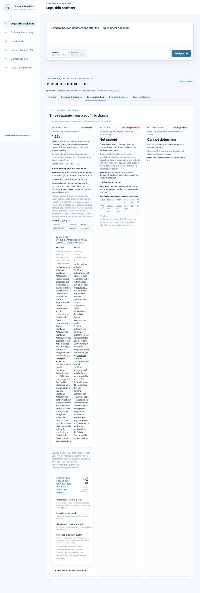
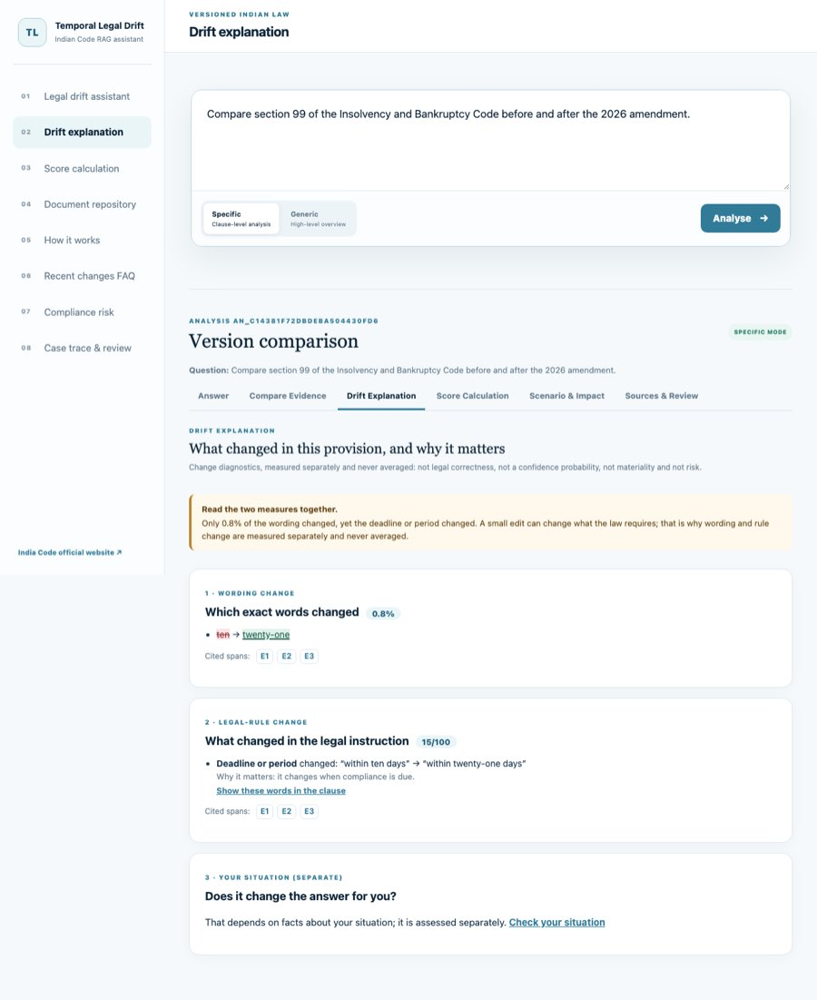
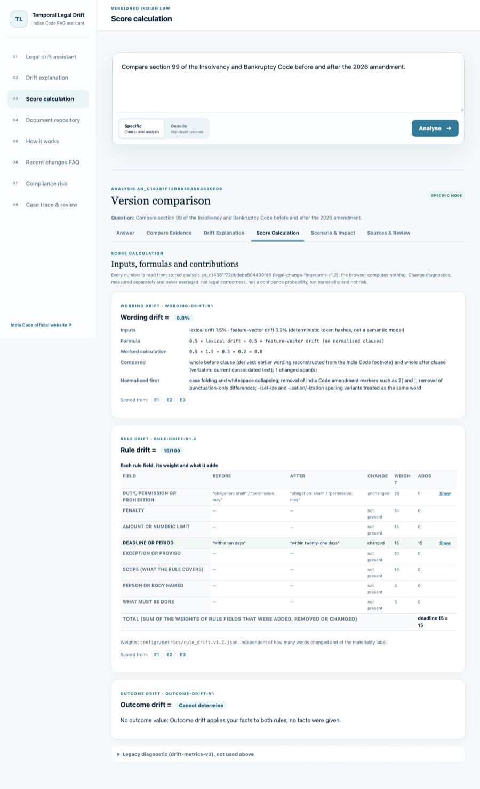
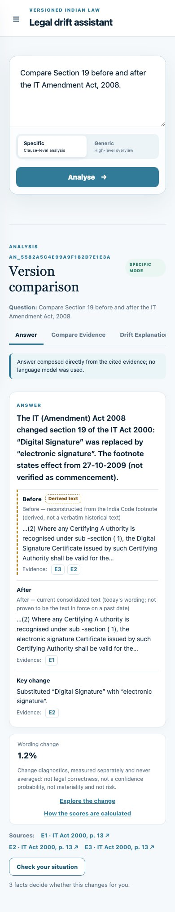
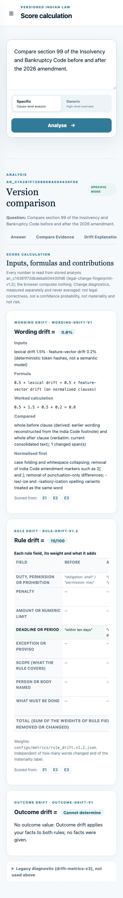

# Analysis workspace v2: separate explanation views and rule-drift v1.2 (rag-answer-v5, 2026-10-13)

This is an engineering report. Nothing here is legal advice, gold labelling, or validated by a legal expert. **Legal validation: UNVERIFIED.** Decision record: ADR 0017. Method delta: `docs/methodology/legal_change_fingerprint.v1.2.md`.

## Before and after

The before screenshots come from the v0.14.0 commit served from a separate worktree. The after screenshots come from this change. All were taken in real headless Chrome.

| v0.14.0 | This change |
| --- | --- |
|  Answer view with a "Cannot determine / needs your facts" strip |  Answer view showing only supported values and one "Check your situation" |
|  IBC s.99 abstained (footnote parser bug) |  IBC s.99 "ten days" → "twenty-one days" answered |
|  one 3,790px "Scores & Method" view |  Drift Explanation ·  Score Calculation |
| |   390px |

Measured in Chrome for IT s.19, DM s.31 and IBC s.99:
- **Empty-assessment words on the Answer view:** 1 per question in v0.14.0; 0 after.
- **Tallest explanation view:** 5,261px in v0.14.0 (DM s.31 Scores & Method); 2,100px after (Score Calculation).
- **History:** back and forward move between views; refresh keeps the view.
- **Navigation and links:** the sidebar "Score calculation" opens that view, and an old `…/scores` link opens Score Calculation.
- **Field links:** "Show the words for Deadline or period" marks exactly “within ten days” / “within twenty-one days” in Compare Evidence.

## Scoring audit (86 corroborated transitions, `reports/fingerprint/heldout_transitions.v2.json`)

| Problem in v1.1 | Example | v1.2 |
| --- | --- | --- |
| Modals inside an inserted list item or Explanation counted as new duties | IBC s.240 (ia), SEBI s.11B Explanation: 25/100 | Scope change, 10/100 |
| One amount or term counted twice | MV s.181 fine: penalty + threshold = 30; THOA s.20 imprisonment: penalty + deadline | Counted once as penalty, 15 |
| Count limits missed | BR s.45ZC "one or more persons not exceeding four": Not scored | Threshold `count:`, 15 |
| Changed authority missed | Companies s.14 Tribunal → Central Government: Not scored | Person or body named, 5 |
| Number words and "consecutive" missed | Companies s.124 "for seven consecutive years"; IBC s.12 "three hundred and thirty days" | Deadline detected |
| Real changes reported as 0/100 | Companies s.134/s.164 new list items; MV s.170 "149" → "150" | Scope 10; Not scored (cross-reference only) |
| "Not scored" without a specific reason | IT s.19 "Digital Signature" → "electronic signature" | Not scored, term substituted, with the words quoted |
| Footnote words with hyphens or line breaks | IBC s.99 `1[twenty-one\ndays]`: abstained | Reconstructed; deadline 15/100 |
| Triage blind to number words | CPC s.32 "five hundred" → "five thousand": Low | Number-normalised input; not Low |

Result:
- **Scored:** 59, with 0 zero scores for changed clauses.
- **Not scored with a reason:** 24 (15 unsupported, 6 cross-reference only, 3 term substituted).
- **No wording score:** 3, where the clause could not be located.
- **Explained disagreements:** 29 cases where a small wording change hides a key-field change.
- **Invariants:** 0 violations. Each value equals the sum of its weights, and each counted field has spans.
- **Changed from v1.1:** 54 rule values.

## Example queries (audit cases v4: 32 cases, 13 Acts)

Offline deterministic composition. Result: 32/32 expected states, with 0 support, pairing or citation errors.

| Case | Act and question | Support | Wording | Rule (fields) | Outcome | Answer tab shows | Result |
|---|---|---|---|---|---|---|---|
| arb-s7-specific | How did section 7 of the Arbitration and Conciliation Act change after t… | graph transition fragments | 1.9% | 10/100 (scope (what the rule covers)) | Cannot determine | wording 1.9%, rule 10/100; Check your situation (1) | supported change; outcome not decidable by facts |
| arb-s7-generic | How did section 7 of the Arbitration and Conciliation Act change after t… | graph transition fragments | 1.9% | 10/100 (scope (what the rule covers)) | Cannot determine | wording 1.9%, rule 10/100; Check your situation (1) | supported change; outcome not decidable by facts |
| arb-s23-counterclaim | Can a respondent submit a counterclaim in the statement of defence under… | graph transition fragments | 8.4% | 30/100 (duty, permission or prohibition, person or body named) | Cannot determine | wording 8.4%, rule 30/100; Check your situation (2) | supported change; outcome needs facts |
| mv-s173-deposit | What amount must be deposited under section 173 of the Motor Vehicles Ac… | graph transition fragments | 1.8% | 15/100 (amount or numeric limit) | Cannot determine | wording 1.8%, rule 15/100; Check your situation (2) | supported change; outcome needs facts |
| cpc-s32-fine | What is the maximum fine a court can impose under section 32 of the Code… | graph transition fragments | 1.6% | 15/100 (penalty) | Cannot determine | wording 1.6%, rule 15/100; Check your situation (2) | supported change; outcome needs facts |
| mv-s181-penalty | What was the penalty under section 181 of the Motor Vehicles Act before … | graph transition fragments | 5.2% | 15/100 (penalty) | Cannot determine | wording 5.2%, rule 15/100; Check your situation (2) | supported change; outcome needs facts |
| sra-s11-discretion | Is specific performance of a contract still discretionary under section … | graph transition fragments | 5.4% | 25/100 (duty, permission or prohibition) | Cannot determine | wording 5.4%, rule 25/100; Check your situation (2) | supported change; outcome needs facts |
| patents-s60-period | What time period applies under section 60 of the Patents Act after the 2… | graph transition fragments | 1.9% | 15/100 (deadline or period) | Cannot determine | wording 1.9%, rule 15/100; Check your situation (2) | supported change; outcome needs facts |
| brega-s45zc-nominees | How many nominees can a depositor make under section 45ZC of the Banking… | graph transition fragments | 1.8% | 15/100 (amount or numeric limit) | Cannot determine | wording 1.8%, rule 15/100; Check your situation (1) | supported change; outcome not decidable by facts |
| companies-s46-compare | Compare section 46 of the Companies Act before and after the Companies (… | graph transition fragments | 4.2% | 5/100 (person or body named) | Cannot determine | wording 4.2%, rule 5/100; Check your situation (1) | supported change; outcome not decidable by facts |
| rti-s13-term | What is the term of office of the Chief Information Commissioner under s… | graph transition fragments | 0.7% | 20/100 (deadline or period, person or body named) | Cannot determine | wording 0.7%, rule 20/100; Check your situation (1) | supported change; outcome not decidable by facts |
| it-s19-specific | Compare Section 19 before and after the IT Amendment Act, 2008. | consolidated footnote reconstruction | 1.2% | Not scored (term substituted) | Cannot determine | wording 1.2%; Check your situation (3) | supported change; outcome needs facts |
| it-s19-generic | Compare Section 19 before and after the IT Amendment Act, 2008. | consolidated footnote reconstruction | 1.2% | Not scored (term substituted) | Cannot determine | wording 1.2%; Check your situation (3) | supported change; outcome needs facts |
| it-s19-risk-match | Compare Section 19 before and after the IT Amendment Act, 2008. + facts {"gazette_notification": true, "government_approval": true, "recognition_in_force": true, "regulatory_conditions_met": true, "is_notified_electronic_signature": false, "is_digital_signature": true} | consolidated footnote reconstruction | 1.2% | Not scored (term substituted) | Changed | wording 1.2%, outcome Changed | supported for stated facts |
| it-s19-risk-mismatch | Compare Section 19 before and after the IT Amendment Act, 2008. + facts {"is_notified_electronic_signature": true} | consolidated footnote reconstruction | 1.2% | Not scored (term substituted) | Cannot determine | wording 1.2%; Check your situation (1) | supported change; outcome needs facts |
| it-2008-privacy-ocr | What changed in the IT Act amendment regarding data privacy? | no supported version | — | — | Cannot determine | answer only | justified abstention |
| wrong-act-companies-competition | Compare section 46 of the Companies Act before and after the Competition… | relation mismatch | — | — | Cannot determine | answer only | justified abstention |
| companies-s105-footnote | What penalty applies under section 105 of the Companies Act after the am… | consolidated footnote reconstruction | 0.8% | 20/100 (penalty, what must be done) | Cannot determine | wording 0.8%, rule 20/100; Check your situation (2) | supported change; outcome needs facts |
| wildlife-s11-omission | What was omitted from section 11 of the Wild Life (Protection) Act by th… | weak transition only | — | — | Cannot determine | answer only | justified abstention |
| factories-not-in-graph | Compare section 2 of the Factories Act before and after the 2016 amendme… | no supported version | — | — | Cannot determine | answer only | justified abstention |
| cpa-mediation-general | What does the Consumer Protection Act say about mediation? | not a comparison | — | — | — | answer only | general QA |
| thoa-punishment-general | What is the punishment for removal of human organs without authority und… | not a comparison | — | — | — | answer only | general QA |
| jan-vishwas-general | What happened in the Jan Vishwas Act? | not a comparison | — | — | — | answer only | general QA |
| dm-s31-frequency | How often must the district disaster management plan be reviewed under s… | graph transition fragments | 2.0% | 15/100 (deadline or period) | Cannot determine | wording 2.0%, rule 15/100; Check your situation (2) | supported change; outcome needs facts |
| dm-s31-month6-unchanged | How often must the district disaster management plan be reviewed under s… + facts {"elapsed_months": 6} | graph transition fragments | 2.0% | 15/100 (deadline or period) | Unchanged | wording 2.0%, rule 15/100, outcome Unchanged; Check your situation (1) | supported for stated facts |
| dm-s31-month18-changed | How often must the district disaster management plan be reviewed under s… + facts {"elapsed_months": 18} | graph transition fragments | 2.0% | 15/100 (deadline or period) | Changed | wording 2.0%, rule 15/100, outcome Changed; Check your situation (1) | supported for stated facts |
| dm-s31-fact-in-question | After 18 months without a review, is the district disaster management pl… | graph transition fragments | 2.0% | 15/100 (deadline or period) | Changed | wording 2.0%, rule 15/100, outcome Changed; Check your situation (1) | supported for stated facts |
| ibc-s99-deadline-footnote | Compare section 99 of the Insolvency and Bankruptcy Code before and afte… | consolidated footnote reconstruction | 0.8% | 15/100 (deadline or period) | Cannot determine | wording 0.8%, rule 15/100; Check your situation (2) | supported change; outcome needs facts |
| ibc-s99-day15-flips | Compare section 99 of the Insolvency and Bankruptcy Code before and afte… + facts {"elapsed_days": 15} | consolidated footnote reconstruction | 0.8% | 15/100 (deadline or period) | Changed | wording 0.8%, rule 15/100, outcome Changed; Check your situation (1) | supported for stated facts |
| ibc-s99-day25-unchanged | Compare section 99 of the Insolvency and Bankruptcy Code before and afte… + facts {"elapsed_days": 25} | consolidated footnote reconstruction | 0.8% | 15/100 (deadline or period) | Unchanged | wording 0.8%, rule 15/100, outcome Unchanged; Check your situation (1) | supported for stated facts |
| ibc-s240-list-item | Compare section 240 of the Insolvency Bankruptcy Code before and after t… | graph transition fragments | 0.5% | 10/100 (scope (what the rule covers)) | Cannot determine | wording 0.5%, rule 10/100; Check your situation (1) | supported change; outcome not decidable by facts |
| mv-s170-cross-reference | Compare section 170 of the Motor Vehicles Act before and after the Motor… | graph transition fragments | 1.0% | Not scored (cross reference only) | Cannot determine | wording 1.0%; Check your situation (1) | supported change; outcome not decidable by facts |

The **model timeout** case is a fixture case, not part of the audit set. `fixtures/rag_answer_v5.json` key `timeout` holds a general question asked with a configured local model. The model ran behind a real socket that never answered, with a 2-second limit. The response is labelled `extractive_fallback`, and the Answer view says "Configured local model was unavailable: TimeoutError; this answer was produced without it."

A **10-to-15-day change** does not exist in this corpus. The nearest real case is IBC s.99, 10 → 21 days: day 15 flips and day 25 does not. The constructed 10 → 15-day clause stays in `tests/unit/test_fingerprint.py` and is labelled SYNTHETIC there.

## Verification executed

- **Python:** 280 tests under 3.14 and 3.11; `validate-contract`; `check-gates` (Phase 11 checksum passes only after the release record).
- **Frontend:** 32 vitest tests against real v5 responses, run 3 times. They cover:
  - the clean Answer view on 8 cases;
  - identical content when revisiting all six views;
  - Score Calculation is never blank when the Answer view shows a score (all 17 fixtures);
  - each rule total reproduced from the shown contributions and the v1.2 weights;
  - field-to-words links;
  - specific not-scored reasons;
  - identical Generic and Specific calculations;
  - labelled hypothetical values;
  - the facts form payload and the deadline flip / no flip;
  - abstention and OCR;
  - opening a stored v4 record;
  - deep links, old `scores` links, the sidebar views, back/forward;
  - arrow keys and narrow-screen CSS.
- **Real Chrome:** `views.mjs` covered every view at 1280px and 390px for three questions, plus history and link checks. `frontend/scripts/browser-a11y-check.mjs`, updated for six views, passes:
  - arrow keys reach Score Calculation;
  - Enter and Space toggle its details;
  - every control is named, with visible focus;
  - no page-level horizontal scroll at 320, 360, 414 or 480px on Answer, Drift Explanation and Score Calculation.

  The a11y run found a page overflow caused by an `sr-only` table header escaping its scroll container. It was fixed with `position:relative` and is covered by a test.

## Not verified

- Legal correctness of any field detection, triage label, decisive fact or assumption.
- A screen-reader listening pass; only the accessibility tree was checked.
- A general answer from a live model; only the timeout path ran.
- **Remaining method limits:** the actor stop-list is a shortcut; action extraction is heuristic; cross-reference renumbering still triages as Medium materiality.
